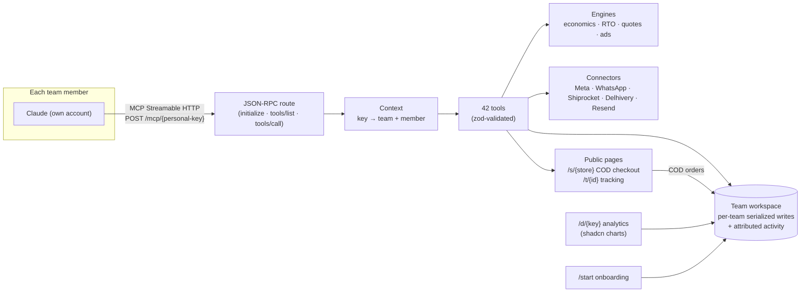

# 🚀 Buildathon: Make Wednesdays Great Again

**Masters' Union · For AI Developers · Winner gets Rs. 25,000**

> **Every team must build in a fork of this repository.** Projects not built in a fork of this repo won't be judged.

| | |
|---|---|
| **Date** | Wednesday, 18 November 2026 |
| **Hacking** | **3:00 PM – 7:00 PM IST** (code freeze at 7:00 PM sharp) |
| **Venue** | CDS Audi, 8th floor |
| **Prize** | Rs. 25,000 to the winning team |
| **Register your fork** | 👉 **[https://forms.gle/ZJUYKwTYjsMsVB2b9](https://forms.gle/ZJUYKwTYjsMsVB2b9)** (**deadline 3:30 PM IST**) |
| **Final submission** | Your fork as it stands at **7:00 PM IST**. There's nothing else to submit. |

> 🤖 **Using an AI coding agent?** Point it at [`AGENTS.md`](AGENTS.md). It has the full event brief, tracks, judging and rules in a form agents can read directly. Claude Code loads it automatically through `CLAUDE.md`, and Codex reads `AGENTS.md` natively.

---

## 🎯 Pick one build track

| # | Track | Brief |
|---|---|---|
| **01** | **Build for the Physical World** | Make a real-world task easier, faster or more reliable. Show it in a realistic scenario. |
| **02** | **Build for AI Agents** | Find something an agent struggles with. Build the tool that fixes it, then demo the agent using it. |
| **03** | **Build in Your Area of Expertise** | Pick a field you know firsthand. Ship a working product that improves how people handle it today. |

## ⚖️ How you'll be judged (each criterion is ⅓ of your score)

| Criterion | The question judges ask |
|---|---|
| **Working product** | Does it do what you say it does? Show the core workflow in your demo. |
| **Problem insight** | Who faces this problem, and why does it happen? |
| **Depth of execution** | How well did you solve the hardest part of the build? |

---

## Why fork this repo?

Everyone starts from the same commit (the **genesis commit**) at the same time. Organizers can then check that:
- all code was written **during** the Buildathon and not brought in from an earlier project,
- teams commit steadily instead of pasting in one huge AI-generated dump at the end,
- every repo stays public and visible while you build.

The organizers track every fork automatically: commits, timing and activity. Read [RULES.md](RULES.md) before you write any code.

---

## ✅ Setup (about 5 minutes, do it at 3:00 PM)

**In short:** fork → register your fork in the form **by 3:30 PM** → build → push before 7:00 PM.

### 1. Fork this repo
Click **Fork** (top right). On the fork screen:
- **Owner:** one team member's personal account. Only **one fork per team**.
- **Repository name:** `buildathon-<team-name>`, for example `buildathon-byte-bandits`
- Click **Create fork**.

> ⚠️ Don't download a ZIP or copy the files into a new repo. **It has to be a real GitHub fork**, or the tracker can't see you.

### 2. Keep it public
Forks of a public repo are public. **Don't make it private, archive it, or delete it** until judging is over.

### 3. Add your teammates
In your fork: **Settings → Collaborators → Add people**. Add each teammate's GitHub account so their commits count toward the team.

### 4. Enable Actions
Open the **Actions** tab of your fork and click **"I understand my workflows, go ahead and enable them"**. This runs the automatic check on every push.

### 5. Make your registration commit (your first commit)
Fill in [`team.json`](team.json). `track` must be one of `physical-world`, `ai-agents` or `area-of-expertise`. Then:

```bash
git clone https://github.com/<your-username>/buildathon-<team-name>.git
cd buildathon-<team-name>
# edit team.json
git add team.json
git commit -m "register: <team name>"
git push
```

The **Hackathon check** in the Actions tab should go green ✅. If it's red, open the run to see what's wrong in `team.json`.

### 6. Register your fork (deadline: 3:30 PM IST)
👉 **[https://forms.gle/ZJUYKwTYjsMsVB2b9](https://forms.gle/ZJUYKwTYjsMsVB2b9)**

It's a 4-question Google Form: team name, fork link, track, team members. It connects your repo to the organizers' live tracker.

- Fill it in **once per team**, right after forking, and **no later than 3:30 PM IST**. **Teams that don't register can't be tracked.**
- Paste your **fork's** URL (`https://github.com/<you>/buildathon-<team-name>`), not this starter repo's.
- Need to change something? Use the **"Edit your response"** link on the confirmation page. Don't fill it in twice.
- **Final submission is automatic.** Whatever is pushed to your fork at 7:00 PM IST is what gets judged.

---

## 🛠 While you build (3:00 – 7:00 PM)

- Put your code anywhere in the repo (`app/`, `src/`, `frontend/`, `backend/`…). There's no required layout.
- **Commit early, commit often**, at least every 30 minutes of real work, with messages that say what changed.
- **Push regularly.** Commits you never push don't exist to the tracker.
- AI coding tools (Claude Code, Codex, Cursor, Copilot…) are **allowed and encouraged**. Keep `AGENTS.md` and `CLAUDE.md` in the repo; they keep your agent within the rules.
- Before 7:00 PM, replace the "Your project" section below with your project's README.

## 🧊 Code freeze: 7:00 PM IST

At 7:00 PM the tracker takes a snapshot of every fork. **Commits pushed after code freeze are ignored.** Judges look at your last commit before 7:00 PM.

## ❌ Things that get you flagged

- Rewriting history (`git push --force`, rebasing away the genesis commit, squashing everything into one commit)
- Commits dated before 3:00 PM
- One or two giant commits containing most of the project
- A repo that isn't a fork of this one, or that's private or deleted

See [RULES.md](RULES.md) for the full list.

---

## Your project

# DropOS: everything a student dropshipping team needs, end to end, inside Claude

**DropOS is a remote MCP server that runs an Indian COD dropshipping business from inside each team member's own Claude.** A team creates itself in two minutes. Every member adds a personal DropOS connector link to Claude and then just talks: *"which of our products actually make money?"*, *"log this supplier's WhatsApp reply"*, *"publish our store page"*, *"launch our Meta test campaign"*, *"which COD orders shouldn't we ship?"*, *"ship the safe ones and send customers their tracking links"*.

Claude does the thinking and writing. DropOS supplies what Claude can't do alone:
- correct India-specific unit economics, computed rather than guessed;
- a shared, persistent team workspace with per-person attribution;
- domain engines: RTO risk scoring, Hinglish quote parsing, and kill/scale decisions for ads;
- real actions: live store pages with COD checkout, Meta Marketing API campaigns, Shiprocket/Delhivery tracking, and WhatsApp + email to customers.

| | |
|---|---|
| **Team** | Cuck Coderz: Arnav Sharma ([@arnavsharma30](https://github.com/arnavsharma30)), Aarush Goel ([@aarush1503](https://github.com/aarush1503)), Sshaurya Aggarwal ([@Sshaurya-code](https://github.com/Sshaurya-code)) |
| **Track** | 03 · Build in Your Area of Expertise (`area-of-expertise`). We are Masters' Union students; the Dropship Challenge is our own programme. |
| **Live** | https://hack.icedoutai.com: landing page and `/start` onboarding |
| **Verified in real Claude** | A teammate added DropOS as a custom connector in claude.ai. Claude loaded the tools and ran `analyze_products` → `get_team_overview` → `add_products` on the team's real product list; server logs show `initialize` (protocol 2025-11-25), `tools/list` and the three `tools/call`s. |
| **Stack** | Next.js 16 (App Router) · TypeScript · zod v4 · MCP over Streamable HTTP (hand-written, stateless JSON-RPC) · shadcn/ui charts (Recharts) · Tailwind v4 · file-backed storage · Cloudflare Tunnel |
| **Size** | 42 MCP tools · ~8,000 lines of TypeScript written during the event · 55+ commits |

---

## 1. The problem: who has it and why it happens

**Who:** first-year students in the Masters' Union **Dropship Challenge**. In a few weeks, small teams must run a real D2C business:
- pick products;
- source them from Indian wholesalers (mostly IndiaMART);
- build a store and run Meta ads;
- ship cash-on-delivery orders across India.

Almost nobody on these teams has done it before.

**What goes wrong, and why:**

1. **Teams pick products by naive margin.** "Price − cost − shipping" looks like 60-70%, but in India most first-time buyers pay COD and a large share of COD parcels are refused or undeliverable (RTO). Every RTO still costs forward shipping, reverse shipping and the ad that produced the order, and some returned units come back damaged. Expected profit per order *placed* can be negative while the naive margin looks great. Example from our model with default assumptions (70% COD, 30% COD RTO, ₹220 ad cost per order): an insulated bottle at ₹449 with ₹190 cost shows a **43% naive margin but loses ₹125 per order placed**.
2. **Sourcing is chaos in WhatsApp.** Dozens of IndiaMART sellers reply in Hinglish (*"rate 180 + 18% gst, moq 20 pcs, dispatch 2 din me, cod nahi, shipping 60 extra"*). Nobody compares them on what dropshipping actually needs: shipping straight to the customer, COD, blind (unbranded) packing, dispatch time and *landed* cost.
3. **Ads run on gut feel.** Without a break-even cost per acquisition (CPA) that accounts for RTO, teams scale losing ad sets and kill winners too early.
4. **Every COD order gets shipped blindly.** Fake numbers, one-word addresses, high-refusal pincodes and repeat refusers all go out the door, and each one becomes an RTO.
5. **Work is scattered.** Sourcing lives in one person's WhatsApp, ads in another's Ads Manager, orders in a spreadsheet. Nobody knows who did what.

**Why existing tools don't fix it:** dashboards and Shopify apps assume an experienced operator, and spreadsheets don't act. A general-purpose AI assistant alone gets the India COD/RTO math wrong or vague, forgets the team's suppliers and orders between chats, keeps each teammate in a separate silo, and can't publish a store, launch ads or track a courier.

---

## 2. What DropOS is

```
 Team member ──talks──▶ their own Claude ──MCP (Streamable HTTP)──▶ DropOS server (our VM)
                                                                    ├─ deterministic engines (economics, RTO, quotes, ads)
                                                                    ├─ shared team workspace + activity log
                                                                    ├─ public pages: /s/<store> (COD checkout), /t/<id> (tracking)
                                                                    └─ connectors: Meta Marketing API · WhatsApp Cloud API · Shiprocket · Delhivery · Resend
```

- **MCP first, so it's easy to adopt.** No new app to learn. Students already use Claude; DropOS turns it into an operator for their store.
- **Personal connector links.** Each member's link (`/mcp/<key>`) identifies their team *and* them, so every change lands in a shared team log with the person's name ("Aarush moved supplier Shree Balaji to quoted").
- **No LLM key on the server.** All 42 tools are deterministic; the intelligence is the team's own Claude. That makes it cheap to run and keeps the numbers reproducible.
- **Web surfaces, kept minimal:**
  - a landing page;
  - a one-question-at-a-time **onboarding wizard** that hands out connector links, shows live when each teammate's Claude connects, and suggests first messages built around the team's own products;
  - the customer-facing **store pages** and **tracking pages**.

### How a team starts (2 minutes)

1. https://hack.icedoutai.com → **Get started**.
2. Answer one question at a time: team name, store name, teammates with their 10-digit mobile numbers, then the 5-10 products you're considering. Each product shows its **real profit per order after COD returns** live as you type.
3. Each member copies their link into **Claude → Settings → Connectors → Add custom connector**. The wizard flips to "Connected ✓" the moment their Claude connects.
4. Talk to Claude. That's the whole interface: no dashboard to learn.

### Example (real tool output, shortened)

> **Team:** We're thinking posture belt ₹699 (cost ₹159), water bottle ₹449 (cost ₹190) and a portable blender ₹1,199 (cost ₹320). Which should we run?
>
> **Claude, via `analyze_products`:**
> ```
> Product            Price   Cost  Naive  Real/order  BE-CPA  MaxRTO  Verdict
> Portable Blender  ₹1,199   ₹320    67%       ₹342    ₹562     79%  GO
> Posture Belt        ₹699   ₹159    68%        ₹90    ₹310     53%  GO
> Water Bottle        ₹449   ₹190    43%      -₹125     ₹95       —  FIX PRICING (price ≥ ₹680 for a ₹50 cushion)
> ```

---

## 3. End to end: every stage of the challenge

| Stage | The team says… | DropOS does | Tools |
|---|---|---|---|
| **Pick products** | "Here are our 6 ideas with prices." | RTO-adjusted profit per order placed, break-even CPA, max COD RTO each product survives, break-even ROAS, GO / FIX PRICING / DROP with the price needed | `add_products`, `analyze_products`, `update_product`, `remove_product`, `set_economics_assumptions` |
| **Find suppliers** | "Find suppliers for the posture belt." | Sourcing playbook with IndiaMART / TradeIndia / Alibaba search links, a **target landed cost derived from the RTO math**, and a vetting checklist (GST, TrustSEAL, dropship, COD, blind shipping, sample). Claude browses with its own web search and logs real suppliers. | `find_suppliers`, `record_supplier` |
| **Outreach & quotes** | "Message them all." / "This supplier replied: …" | Hinglish WhatsApp / email / IndiaMART messages with one-click links. Pasted replies are **parsed into structured quotes**: unit price, GST, MOQ, shipping, dispatch days, dropship / COD / blind flags, landed cost. The tool also lists what the supplier *didn't* answer. Quotes are ranked by real profit per order. | `supplier_outreach_campaign`, `supplier_outreach_message`, `record_quote`, `compare_quotes`, `finalize_supplier` |
| **Store** | "Write our store page in Hinglish and publish it." | Claude writes the copy; DropOS validates it and publishes a live single-product store at `/s/<slug>` with a **Cash-on-Delivery order form** (phone and pincode validation). It **refuses invented social proof**: no fabricated reviews, ratings, sales counts or fake scarcity. | `publish_store_page`, `list_store_pages` |
| **Creatives** | "Save these 3 ad angles." | Stores Claude-written hooks, primary text, headlines and Reel shot lists per product | `save_creatives`, `list_creatives` |
| **Meta ads** | "Launch our test campaign." | Plans an ABO test from break-even CPA, then **creates the campaign, ad sets, ad creatives and ads in the team's own ad account through the Meta Marketing API**, all **PAUSED until the team confirms**. Pulls results back, and gives KILL / WAIT / KEEP / SCALE with reasons. Pauses losers and raises winners' budget 20% only on explicit confirm. | `plan_meta_campaign`, `meta_launch_campaign`, `meta_sync_results`, `log_ad_results`, `ad_decisions`, `meta_apply_decisions`, `meta_status` |
| **Outbound to customers & leads** | "Send our opted-in customers the Diwali offer." | Contacts list (leads + past customers) and WhatsApp / email campaigns with `{{name}}`/`{{store}}` personalisation. **Consent-first**: only opted-in contacts receive messages, opt-outs are honoured, "Reply STOP to opt out" is appended automatically, and sending requires explicit confirmation. | `add_contacts`, `import_customers_as_contacts`, `create_outbound_campaign`, `send_outbound_campaign`, `outbound_report`, `opt_out_contact` |
| **Orders** | "Sync our website orders." / "Import this Shopify CSV." | Pulls COD orders placed on the team's DropOS store pages; imports Shopify order exports or structured lists | `sync_website_orders`, `import_orders`, `update_order_status` |
| **Stop RTO before it ships** | "Which COD orders shouldn't we ship?" | Scores every pending order, riskiest first, with the reasons. Recommends **ship / confirm + prepaid offer / call + ₹99 advance / hold**, drafts the customer WhatsApp, and shows the batch impact (sample batch: **27% expected RTO shipped blindly → 5% following the actions, ₹680 saved**) | `rto_check`, `customer_message` |
| **Ship & track** | "Ship the confirmed orders with Delhivery and notify customers." | Creates shipments (Shiprocket / Delhivery AWB, or a built-in demo courier). **`track_shipments` refreshes every in-flight shipment for the team from Shiprocket / Delhivery**, normalises statuses into one timeline (booked → picked up → in transit → out for delivery → delivered / failed attempt / RTO), and **sends the customer WhatsApp + email updates with a live tracking link** (`/t/<id>`) at each milestone. Delivered and returned parcels update the order, and returns feed the RTO engine's repeat-refuser signal. | `create_shipment`, `track_shipments`, `notify_customer` |
| **Connect accounts** | "Connect my Shiprocket." | Per-team credentials for Meta, WhatsApp Cloud API, Shiprocket, Delhivery and Resend. Shiprocket and Meta are **verified against their APIs before saving**; credentials are masked in every response. | `connect_integration`, `disconnect_integration`, `list_integrations` |
| **Team** | "What did Aarush do today?" | Overview with prioritised next actions; activity attributed per member | `get_team_overview`, `team_activity` |

---

## 4. Full tool reference (42 tools)

**Team (2)**
- `get_team_overview`: start here. Team, members, products with real profit per order, pipeline status, prioritised next actions.
- `team_activity`: who did what, filterable by member.

**Products, economics, suppliers, creatives, ads (15)**
- `add_products`: adds 1-10 products. Shows naive vs real profit and break-even CPA, and estimates and flags a missing cost.
- `update_product`, `remove_product`.
- `analyze_products`: ranked verdict table: naive %, real ₹/order, break-even CPA, max COD RTO, break-even ROAS, GO/FIX/DROP and the price needed.
- `set_economics_assumptions`: COD share, COD/prepaid RTO, CPA, COD and gateway fees, reverse shipping, damaged-unit rate, packaging. Shows before/after profit for every product.
- `record_supplier`, `supplier_outreach_message`.
- `record_quote`: parses Hinglish replies (explicit fields override) and lists the unanswered questions.
- `compare_quotes`: ranks by real profit per order, with warnings.
- `finalize_supplier`: sets landed cost and moves the product to sourcing.
- `save_creatives`, `list_creatives`.
- `plan_meta_campaign`: ABO plan from break-even CPA. Refuses if the product loses money before ads.
- `log_ad_results`: sets cumulative Ads Manager numbers.
- `ad_decisions`: KILL / WAIT / KEEP / SCALE, with CTR, CPC, CPM, CPA, ROAS and RTO-adjusted ROAS.

**Store, orders, RTO, shipping, integrations (13)**
- `publish_store_page`: Claude's copy over a safe default. Rejects invented social proof, checks per-team slug ownership, and returns the live URL.
- `list_store_pages`, `sync_website_orders`.
- `import_orders`: Shopify CSV, a structured list, or sample orders.
- `rto_check`, `update_order_status`.
- `customer_message`: Hinglish WhatsApp for confirm / prepaid offer / ₹99 advance / fix address / shipped.
- `connect_integration`, `disconnect_integration`, `list_integrations`.
- `create_shipment`, `track_shipments`, `notify_customer`.

**Sourcing, Meta Marketing API, outbound (12)**
- `find_suppliers`.
- `supplier_outreach_campaign`.
- `meta_launch_campaign`: campaign, ad sets, creatives and ads, PAUSED by default. Demo mode is clearly labelled when Meta isn't connected.
- `meta_sync_results`.
- `meta_apply_decisions`: changes Meta only with `confirm: true`.
- `meta_status`.
- `add_contacts`, `import_customers_as_contacts`.
- `create_outbound_campaign`.
- `send_outbound_campaign`: requires `confirm: true`.
- `outbound_report`, `opt_out_contact`.

The server's MCP `instructions` give Claude the recommended order: overview → products → suppliers → store → creatives → ads → orders → RTO → shipping.

---

## 5. Integrations

| Provider | Used for | How it's called | Status |
|---|---|---|---|
| **Meta Marketing API** (Graph v21.0) | Campaigns, ad sets, ad creatives, ads; insights; pause / budget changes | `act_{id}/campaigns`, `/adsets`, `/adcreatives`, `/ads`, `/{adset}/insights`; budgets in paise; OUTCOME_SALES with pixel + PURCHASE, else OUTCOME_TRAFFIC; India geo targeting | Implemented. Connect verifies the ad account and fails cleanly on bad tokens. Full launch tested in clearly-labelled demo mode (no live ad account during the event). |
| **WhatsApp Business (Cloud API)** | Shipment updates, order confirmations, outbound campaigns | `POST graph.facebook.com/v21.0/{phoneNumberId}/messages` (templates supported for business-initiated messages) | Implemented. Without credentials, messages are queued with one-click `wa.me` links. |
| **Shiprocket** | Courier tracking | `POST /v1/external/auth/login` → `GET /courier/track/awb/{awb}` | Implemented. Login is verified on connect (bad credentials are rejected with Shiprocket's own error). |
| **Delhivery** | Courier tracking | `GET track.delhivery.com/api/v1/packages/json/?waybill=` with `Authorization: Token` | Implemented. The real endpoint returns 401 for a fake token, which is surfaced on the shipment. |
| **Resend** | Tracking emails, outbound email | `POST api.resend.com/emails` | Implemented. Queued with `mailto:` links when not connected. |
| **IndiaMART / TradeIndia / Alibaba** | Supplier discovery | Search links plus Claude's own web search; suppliers are logged with `record_supplier` | IndiaMART renders results client-side (verified), so we don't scrape it. |
| **Demo courier** | Demos without courier keys | Deterministic simulator through real Indian hubs | Always on |

No Shopify is needed: DropOS publishes the store itself. Shopify CSV import is supported for teams that already have one.

---

## 6. Architecture



- **Protocol** (`web/src/app/mcp/[token]/route.ts`): stateless JSON-RPC over MCP Streamable HTTP. It handles `initialize` (negotiates 2025-11-25 / 2025-06-18 / 2025-03-26 / 2024-11-05), `notifications/*` (202), `ping`, `tools/list` and `tools/call`, plus empty `resources/list` and `prompts/list`. Tool errors come back as `isError` results with a readable message so Claude can recover. Every method is logged per member.
- **Identity** (`web/src/mcp/context.ts`): 128-bit random keys map to `{teamId, memberId}`. The first `initialize` marks the member as connected, which drives the onboarding indicator.
- **Shared state and attribution:**
  - `ctx.update(fn)` does a per-team serialized read-modify-write with atomic file writes (`web/src/lib/team-store.ts`), so two teammates' Claudes acting at once never lose each other's changes.
  - Activity lines are derived from the before/after diff of each write and attributed to the calling member (`web/src/lib/merge.ts`).
- **Tool schemas** (`web/src/mcp/registry.ts`): zod v4 schemas → JSON Schema, simplified to the subset every MCP client accepts. Arguments are still validated in full server-side.
- **Storage:** JSON files under `web/data/` (teams, key index, store pages, store orders, shipments, per-team integrations and marketing data). Everything is serialized per key and written atomically. Credentials are stored per team with mode 0600 and masked in all responses.

**Repository map**

| Path | What |
|---|---|
| `web/src/app/mcp/[token]/route.ts` | MCP endpoint |
| `web/src/mcp/` | Context, registry, tools (`team.ts`, `growth.ts`, `ops.ts`, `marketing.ts`) |
| `web/src/lib/economics.ts` | RTO-adjusted unit economics |
| `web/src/lib/rto.ts` | RTO risk engine and batch impact |
| `web/src/lib/suppliers-demo.ts` | Hinglish quote parser, outreach templates, quote scoring |
| `web/src/lib/ads.ts` | Ad metrics and KILL/WAIT/KEEP/SCALE engine |
| `web/src/lib/meta.ts` · `outbound.ts` | Meta Marketing API client · contacts and campaigns |
| `web/src/lib/couriers.ts` · `shipping-store.ts` · `notify.ts` | Shiprocket/Delhivery clients and status model · shipments and integrations · WhatsApp/email |
| `web/src/lib/site.ts` · `site-store.ts` | Store themes and safe default copy · published stores and their orders |
| `web/src/lib/team-store.ts` · `merge.ts` | Teams, members, atomic writes · diff → activity |
| `web/src/app/page.tsx` · `start/` | Landing · onboarding wizard |
| `web/src/app/s/[slug]/` · `t/[id]/` · `api/sites/[slug]/orders` | Public store with COD checkout · customer tracking page · store order intake |

---

## 7. The hardest parts and how we solved them

### 7.1 Unit economics that tell the truth about COD (`web/src/lib/economics.ts`)

Everything is computed **per order placed**, because that's what an ad buys:

```
blendedRTO   = codShare × rtoCOD + (1 − codShare) × rtoPrepaid
delivered    = 1 − blendedRTO
revenue      = delivered × price
costs        = landedCost × (delivered + blendedRTO × damagedShare)    # returned units are sometimes lost
             + forwardShipping                                          # paid on every order
             + blendedRTO × reverseShipping
             + codShare × (1 − rtoCOD) × price × codFee%                # COD remittance on delivered COD
             + (1 − codShare) × price × gateway%
             + packaging + CPA
profit       = revenue − costs
breakEvenCPA = profit + CPA
maxCodRTO    = solved exactly (profit is linear in rtoCOD)
```

Defaults: 70% COD, 30% COD RTO, 4% prepaid RTO, 2% COD fee, 2% gateway, ₹70 reverse shipping, 10% damaged returns, ₹15 packaging, ₹220 CPA. All are tunable per team with `set_economics_assumptions`. The same break-even CPA drives quote ranking, the target landed cost in `find_suppliers`, the Meta test plan, and every KILL/SCALE call, so the whole pipeline agrees on one number.

### 7.2 Explainable RTO risk scoring (`web/src/lib/rto.ts`)

Each pending order is scored from the signals operators check by hand. Every signal shows its points, so Claude can explain *why* an order is risky:

| Signal | Points |
|---|---|
| Cash on delivery / prepaid | +25 / −20 |
| Metro hub pincode / non-metro / high-refusal postal region / invalid pincode | −8 / +4 / +8 to +16 / +22 |
| Invalid phone / not starting 6-9 / repeated or sequential digits | +22 / +15 / +22 |
| Address under 20 characters / no house number / no street or landmark / test or junk words | +12 / +9 / +5 / +15 |
| Gibberish name / first name only | +10 / +3 |
| Placed 00:00-05:00 IST (impulse) | +6 |
| COD ≥ ₹1,500 / 3+ units on COD | +8 / +6 |
| Refused an earlier parcel / repeat delivered customer / duplicate within 24h | +30 / −15 / +10 |

The score (0-100) gives a band (low < 30 ≤ medium < 50 ≤ high < 70 ≤ critical) and an estimated RTO probability (`0.03 + 0.8 × (score/100)^1.6`, capped at 90%). Each band maps to an action: ship, confirm + ₹50 prepaid offer, call + ₹99 advance, or hold. A batch model compares shipping blindly against following the actions. **Returned parcels reported by Shiprocket/Delhivery automatically become the "refused before" signal**, so the system learns each customer. The weights are heuristic and documented, not a trained model.

### 7.3 A multi-user MCP server with correct shared state

MCP sessions are per Claude, but a dropshipping team is several people. Our approach:
- **Identity:** personal keys map each connection to a team and a member.
- **No lost updates:** all writes go through a per-team queue with atomic file replacement.
- **Attribution:** the activity log comes from diffing each write, so attribution is automatic and complete across 40+ tools without per-tool logging code.
- **Connection status:** the first `initialize` is recorded, which powers the live "Connected ✓" indicator in onboarding.

### 7.4 Messy Hinglish supplier replies → comparable quotes

`record_quote` parses phrases like *"rate 135 + 18% gst"*, *"gst extra 12%"*, *"moq 10 pcs"*, *"dispatch 1-2 din"*, *"cod nahi hoga"*, *"blind packing"* and *"shipping 55 per parcel"* into a structured quote. It computes landed cost (`unit × (1 + GST) + shipping`) and returns **what the supplier didn't answer** (for example the damage / return policy), so Claude asks the right follow-up. `compare_quotes` then ranks suppliers by real profit per order, not by unit price.

### 7.5 Safe by default with real money and real customers

- Meta objects are created **PAUSED**. Budget changes and pauses need `confirm: true`.
- Outbound messages go only to **opted-in** contacts, honour opt-outs, append an opt-out line and need `confirm: true`.
- Store pages **reject invented reviews, ratings, sales counts and fake scarcity**. Real reviews require `reviewsAreReal: true`.
- Credentials are stored per team, verified on connect where possible, and never returned unmasked.
- Demo data (sample orders, demo courier, Meta demo mode) is always labelled as such. Demo order ids (`#D…`) never trigger messages to real numbers.

### 7.6 Making it work in Claude itself

The first real connection showed Claude loading DropOS with no usable tools. We added per-method logging to the endpoint, then simplified the advertised JSON Schemas (dropping `propertyNames`, `format`, `pattern` and exclusive bounds) while keeping full zod validation server-side. Claude then listed and called the tools on the team's real data.

---

## 8. Verification

- **Official MCP client:** the MCP Inspector CLI (`@modelcontextprotocol/inspector --cli … --transport http`) connects to the live server, lists all tools and calls them.
- **Full live run through that client on https://hack.icedoutai.com,** with two members acting:
  - add products → record supplier → Hinglish quote → finalize supplier;
  - publish store page → place a COD order on it → sync it;
  - import orders → RTO check (27% → 5%, ₹680 saved);
  - create a shipment → track it to delivered (WhatsApp + email queued at each milestone) → customer tracking page;
  - team activity attributed to the right members.
- **Meta and outbound, live (demo mode):** sourcing playbook → save creatives → publish store → `meta_launch_campaign` (3 paused ad sets) → `meta_sync_results` → `meta_apply_decisions` (SCALE ₹500→₹600/day, KILL with reasons). Outbound drafts reached only opted-in contacts.
- **Real Claude:** a teammate's claude.ai connector ran `initialize` → `tools/list` → `analyze_products` → `get_team_overview` → `add_products` (server logs).
- **Browser (Playwright) on the live site:** the landing page, onboarding wizard (including the live Connected indicator), store pages, COD checkout and tracking pages all load without page errors.
- **Static checks:** `tsc --noEmit` and `eslint` are clean.
- **Not verified with live credentials** (none were available during the event): actual Meta campaign creation, insights and updates; actual WhatsApp / Resend sends; tracking a real Shiprocket / Delhivery AWB. Those code paths were exercised against the providers' real auth endpoints (bad credentials are rejected cleanly) and in clearly labelled demo mode.

---

## 9. How to run it

```bash
cd web
npm install
npm run build
npx next start -p 3100        # landing at /, onboarding at /start, MCP at /mcp/<key>
```

- No environment variables are required. Optional: `DROPOS_SECRET`; otherwise a secret is generated in `web/data/.secret`.
- Runtime data lives in `web/data/`, which is git-ignored.
- We expose the server publicly at https://hack.icedoutai.com through a Cloudflare Tunnel (`cloudflared tunnel run`, ingress → `localhost:3100`).
- Connect from Claude: create a team at `/start`, then **Settings → Connectors → Add custom connector** → paste the member's link.

## 10. Limitations and next steps

- **Live credentials:** provider integrations need each team's own credentials, and were only tested against auth errors and in demo mode during the event (see §8). WhatsApp business-initiated messages need Meta-approved templates outside the 24-hour window.
- **Storage:** file-backed on one VM, fine for a cohort and simple to back up. A database is the next step for scale.
- **Tracking updates:** tracking is pulled when `track_shipments` runs; courier webhooks would make updates real-time.
- **RTO weights:** heuristic; the next step is calibrating them on each cohort's actual delivered and RTO outcomes, which DropOS already records.
- **Supplier discovery:** relies on Claude's web search plus search links, because IndiaMART renders results client-side.

## 11. How we built it (during the event)

1. **Started as a web CRM**, with product research, suppliers, creatives, Meta ads, orders/RTO, a website builder, shipping and team logins.
2. **Pivoted to MCP-first**, because students already live in Claude and adoption beats dashboards.
3. **Kept the engines and the customer-facing pages** (store pages, tracking pages) and rebuilt everything else as tools.
4. **Added the remaining pieces:** Meta Marketing API and outbound, interactive onboarding, shadcn charts on the landing page, and the fixes found by connecting a real Claude.

The commit history shows each step.
